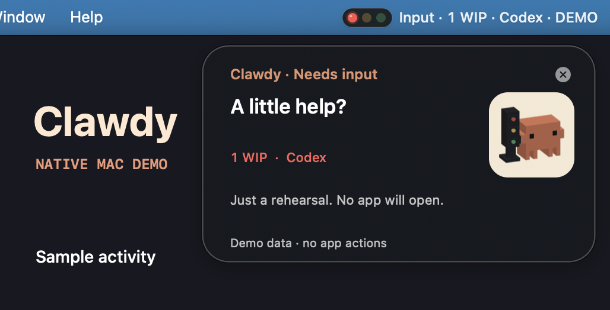

  

<h1 align="center">Virtual Clawdy</h1>

<strong>See when your AI needs you.</strong>

<h2 align="center"><a href="https://alfonsoforcen3.github.io/Clawdy-Virtual/">Visit the Clawdy website ↗</a></h2>

  <a href="https://alfonsoforcen3.github.io/Clawdy-Virtual/#experience"><strong>Try the browser demo</strong></a> ·
  <a href="docs/TRY_VIRTUAL_CLAWDY.md">Build for Mac</a> ·
  <a href="desktop/windows/README.md">Build for Windows</a> ·
  <a href="docs/CUSTOMER_SETUP.md"><strong>Set up a physical Clawdy</strong></a>

You leave an AI coding agent running. An hour later, you discover it stopped five
minutes in to ask a question. Clawdy gives you a small traffic light you can
check at a glance, right in your Mac menu bar or Windows notification area.

### Set up Clawdy with your AI

Paste one line into a local coding agent that can run commands on your computer:

- **I have a toy:** “I bought a new Clawdy. Make it work. Clone https://github.com/alfonsoforcen3/Clawdy-Virtual and follow its setup instructions.”
- **I want the free desktop app:** “Install Virtual Clawdy from https://github.com/alfonsoforcen3/Clawdy-Virtual.”

[Physical setup guide](docs/CUSTOMER_SETUP.md) · [Live desktop status and hooks](docs/LOCAL_STATUS.md)

### Watch Clawdy in action

#### 17-second demo

https://github.com/user-attachments/assets/6b7fc711-e455-431e-a38b-656dfafcf65e

[Watch on the website](https://alfonsoforcen3.github.io/Clawdy-Virtual/#hero-film)

#### 46-second walkthrough

https://github.com/user-attachments/assets/322907c2-873e-484b-a2b7-2aba966a8862

[Watch on the website](https://alfonsoforcen3.github.io/Clawdy-Virtual/#film)

  

| Signal | What it tells you |
| --- | --- |
| 🟠 Amber | Your agent is working. The status card shows active sessions. |
| 🟢 Green | Your agent has reported it’s ready. |
| 🔴 Red | A question or error needs your attention. Supported alerts offer a way back to the chat or app. |

### Try Clawdy

1. [Open the interactive desk demo](https://alfonsoforcen3.github.io/Clawdy-Virtual/#experience) and switch between **Working**, **Done**, and **Your turn**.
2. Build the desktop preview for [macOS 13+](docs/TRY_VIRTUAL_CLAWDY.md) or [Windows 11 x64 / ARM64](desktop/windows/README.md).
3. Start Clawdy. By default, it connects directly to your live local bridge to observe real AI sessions (`--observe`). Pass `--demo` if you want simulated fixture activity without a local bridge.

Use the update controls in the Mac menu bar or Windows tray. Enable
**Automatic Updates** to prepare tested changes from GitHub in the background,
then apply the update on the next normal launch. You can also restart Clawdy
from the update menu as soon as it is ready. Older previews need a one-time
rebuild to get these controls.

Install the [local status service and hooks](docs/LOCAL_STATUS.md) to see live
activity from your selected AI apps, with or without a toy. Windows
is a source preview with automated build and fixture coverage. Hands-on Windows
tray testing is still pending.

### Want one on your desk?

Clawdy and Clawdy Pro Max are optional physical desk companions built in Dubai.
They bring the same traffic lights to your desk, and Pro Max adds a status display.
[See both desk companions](https://alfonsoforcen3.github.io/Clawdy-Virtual/#get-clawdy).

Building with an AI coding agent? [Open an issue](https://github.com/alfonsoforcen3/Clawdy-Virtual/issues/new) and tell us when a signal helped or got in your way.

[MIT license for the host software](LICENSE) · [Artwork and branding terms](NOTICE.md)
